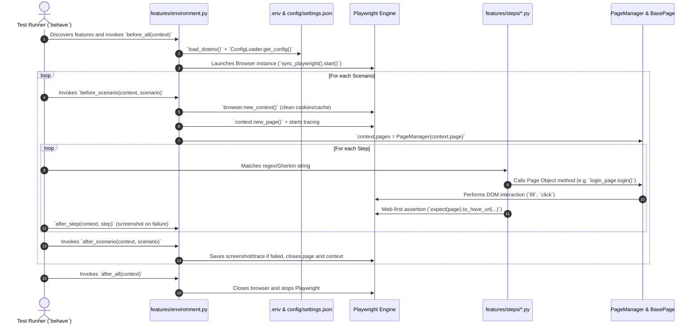

# Automation Interview Playbook & Minimal Starter Guide

A complete reference guide designed for technical pair-programming interviews. This document explains the architecture of the current framework, critical interview tips (UI + API testing), and provides copy-pasteable minimal starter templates so you can spin up a clean project from scratch on any machine.

---

## Table of Contents
1. [Understanding the Current Framework Architecture](#1-understanding-the-current-framework-architecture)
2. [Critical Interview Considerations (Things Candidates Miss)](#2-critical-interview-considerations-things-candidates-miss)
3. [Playwright Native API Testing (Zero External Dependencies)](#3-playwright-native-api-testing-zero-external-dependencies)
4. [Minimal Starter Template (Zero-Bloat, 5-File Project)](#4-minimal-starter-template-zero-bloat-5-file-project)
   - [File Tree](#file-tree)
   - [File 1: `requirements.txt`](#file-1-requirementstxt)
   - [File 2: `.env`](#file-2-env)
   - [File 3: `pages/base_page.py`](#file-3-pagesbase_pagepy)
   - [File 4: `features/environment.py`](#file-4-featuresenvironmentpy)
   - [File 5: `features/sample.feature`](#file-5-featuressamplefeature)
   - [File 6: `features/steps/sample_steps.py`](#file-6-featuresstepssample_stepspy)
5. [Setup & Execution Instructions for Your New Machine](#5-setup--execution-instructions-for-your-new-machine)
6. [Quick Locator & Assertion Cheat Sheet](#6-quick-locator--assertion-cheat-sheet)

---

## 1. Understanding the Current Framework Architecture



### Where Execution Starts & How Variables are Resolved:
1. **Entry Point**: You run `behave`. Behave automatically searches `features/` for `.feature` files and initializes `features/environment.py`.
2. **Global Hooks (`before_all`)**:
   - `load_dotenv()` reads variables from `.env`.
   - `ConfigLoader` reads fallback defaults from `config/settings.json`.
   - Priority hierarchy:
     `os.getenv('BROWSER')` > `settings.json["browser"]` > Default (`"chromium"`).
     `os.getenv('HEADLESS')` > `settings.json["headless"]` > Default (`False`).
   - A single `Browser` instance is launched (`context.browser`).
3. **Scenario Level (`before_scenario`)**:
   - A fresh `BrowserContext` is created (`context.browser.new_context()`). This guarantees 100% test isolation: each scenario starts with an empty cache, no previous session cookies, and zero state leaks.
   - `PageManager` is initialized lazily so page objects are only instantiated when referenced.
4. **Step Execution (`features/steps/*.py`)**:
   - Gherkin steps pass values from the feature file or fetch credentials directly from `os.getenv('STANDARD_USER', 'standard_user')`.
   - Assertions are executed via Playwright's `expect` (web-first assertion).
5. **Teardown (`after_scenario`)**:
   - If `scenario.status == 'failed'`, a screenshot and Playwright trace file are captured and saved to disk.
   - `context.page.close()` and `context.browser_context.close()` prevent memory leaks.

---

## 2. Critical Interview Considerations (Things Candidates Miss)

### A. Screen Sharing & Browser Visibility
- **Headless Mode**: By default in CI tests run headless. In an interview, interviewers want to see the UI interactions. Set `HEADLESS=false`.
- **`slow_mo`**: Playwright executes clicks and typing in milliseconds. Add `slow_mo=100` or `slow_mo=200` to `browser.launch()` so your interviewer can visually follow what the script is doing.

### B. Web-First Assertions (`expect`) vs Python `assert`
- ❌ **Avoid**: `assert page.locator("#title").text_content() == "Products"`
  *(Fails immediately if the element hasn't finished rendering; causes flaky tests).*
- ✅ **Prefer**: `expect(page.locator(".title")).to_have_text("Products")`
  *(Automatically retries with a 5-second polling window until condition is met).*

### C. Language Constraint Verification
- If the interview prompt says *"working local setup in either PHP or JS"*, verify if Python is accepted. If they insist on JS, use Playwright with TypeScript (`npm init playwright@latest`). If Python is accepted, this minimal Behave template is ideal.

---

## 3. Playwright Native API Testing (Zero External Dependencies)

Playwright includes a built-in HTTP client via `playwright.request.new_context()`. You do **not** need `requests`, `httpx`, or `urllib3`.

### Why this impresses interviewers:
1. **Zero extra dependencies**: Keeps your project lightweight.
2. **Unified authentication**: You can execute an API login to obtain auth cookies/tokens and inject them directly into your browser context, bypassing slow UI login screens for backend scenarios.

```python
# Quick API test snippet using Playwright
api_request = playwright.request.new_context(base_url="https://reqres.in/api")
response = api_request.get("/users/2")

assert response.status == 200
data = response.json()
assert data["data"]["email"] == "janet.weaver@reqres.in"
api_request.dispose()
```

---

## 4. Minimal Starter Template (Zero-Bloat, 5-File Project)

Create an empty directory on your machine (e.g. `mkdir interview-starter && cd interview-starter`) and add these files:

### File Tree
```
interview-starter/
├── requirements.txt
├── .env
├── pages/
│   └── base_page.py
└── features/
    ├── environment.py
    ├── sample.feature
    └── steps/
        └── sample_steps.py
```

---

### File 1: `requirements.txt`
```text
playwright>=1.40.0
behave>=1.2.6
python-dotenv>=1.0.0
```

---

### File 2: `.env`
```env
BASE_URL=https://www.saucedemo.com
API_BASE_URL=https://reqres.in/api
STANDARD_USER=standard_user
SECRET_PASSWORD=secret_sauce
HEADLESS=false
SLOW_MO=150
```

---

### File 3: `pages/base_page.py`
```python
"""
Generic BasePage encapsulating common Playwright interactions and locators.
"""
from playwright.sync_api import Page, Locator


class BasePage:
    def __init__(self, page: Page):
        self.page = page

    def goto(self, url: str):
        """Navigate to a target URL."""
        self.page.goto(url)

    def get_by_role(self, role: str, name: str) -> Locator:
        """Find user-facing accessible elements (button, textbox, link, etc.)."""
        return self.page.get_by_role(role, name=name)

    def fill_input(self, selector_or_locator, text: str):
        """Fill input field with text."""
        if isinstance(selector_or_locator, str):
            self.page.locator(selector_or_locator).fill(text)
        else:
            selector_or_locator.fill(text)

    def click(self, selector_or_locator):
        """Click an element."""
        if isinstance(selector_or_locator, str):
            self.page.locator(selector_or_locator).click()
        else:
            selector_or_locator.click()

    def get_text(self, selector: str) -> str:
        """Retrieve inner text."""
        return self.page.locator(selector).inner_text()
```

---

### File 4: `features/environment.py`
```python
"""
Behave lifecycle hooks managing Playwright Browser and API contexts.
"""
import os
from dotenv import load_dotenv
from playwright.sync_api import sync_playwright

load_dotenv()


def before_all(context):
    """Start Playwright and initialize browser + API contexts."""
    context.playwright = sync_playwright().start()

    headless_env = os.getenv("HEADLESS", "false").lower() in ("true", "1", "yes")
    slow_mo = int(os.getenv("SLOW_MO", "100"))

    context.browser = context.playwright.chromium.launch(
        headless=headless_env,
        slow_mo=slow_mo
    )

    # Built-in Playwright HTTP client for API testing
    context.api = context.playwright.request.new_context(
        base_url=os.getenv("API_BASE_URL", "https://reqres.in/api")
    )


def before_scenario(context, scenario):
    """Create isolated browser context and page per scenario."""
    context.browser_context = context.browser.new_context()
    context.page = context.browser_context.new_page()


def after_scenario(context, scenario):
    """Capture screenshot on failure and tear down page context."""
    if scenario.status == "failed":
        safe_name = scenario.name.replace(" ", "_").lower()
        context.page.screenshot(path=f"failed_{safe_name}.png")

    context.page.close()
    context.browser_context.close()


def after_all(context):
    """Teardown API client and browser engine."""
    context.api.dispose()
    context.browser.close()
    context.playwright.stop()
```

---

### File 5: `features/sample.feature`
```gherkin
Feature: Application Smoke Verification (UI & API)

  @ui
  Scenario: Verify successful user login
    Given the user navigates to the login page
    When the user logs in with valid credentials
    Then the user should see the inventory page header

  @api
  Scenario: Verify user retrieval from REST API
    When the user requests API details for user "2"
    Then the API response status code should be 200
    And the response body should contain email "janet.weaver@reqres.in"
```

---

### File 6: `features/steps/sample_steps.py`
```python
"""
Step definitions covering both UI and API scenarios.
"""
import os
import re
from behave import given, when, then
from playwright.sync_api import expect

from pages.base_page import BasePage


# ==========================================
# UI Step Definitions
# ==========================================

@given('the user navigates to the login page')
def step_navigate_login(context):
    context.base_page = BasePage(context.page)
    url = os.getenv("BASE_URL", "https://www.saucedemo.com")
    context.base_page.goto(url)


@when('the user logs in with valid credentials')
def step_login_valid(context):
    username = os.getenv("STANDARD_USER", "standard_user")
    password = os.getenv("SECRET_PASSWORD", "secret_sauce")

    context.page.locator("[data-test='username']").fill(username)
    context.page.locator("[data-test='password']").fill(password)
    context.page.locator("[data-test='login-button']").click()


@then('the user should see the inventory page header')
def step_verify_inventory(context):
    # Web-First URL Assertion
    expect(context.page).to_have_url(re.compile(r".*inventory\.html"))
    # Web-First Locator Assertion
    title = context.page.locator(".title")
    expect(title).to_be_visible()
    expect(title).to_have_text("Products")


# ==========================================
# API Step Definitions (Using context.api)
# ==========================================

@when('the user requests API details for user "{user_id}"')
def step_request_user(context, user_id):
    context.api_response = context.api.get(f"/users/{user_id}")


@then('the API response status code should be {status_code:d}')
def step_verify_status(context, status_code):
    assert context.api_response.status == status_code, (
        f"Expected {status_code}, got {context.api_response.status}"
    )


@then('the response body should contain email "{expected_email}"')
def step_verify_email(context, expected_email):
    json_data = context.api_response.json()
    actual_email = json_data.get("data", {}).get("email")
    assert actual_email == expected_email, (
        f"Expected {expected_email}, got {actual_email}"
    )
```

---

## 5. Setup & Execution Instructions for Your New Machine

When you open your new computer, run these steps in your terminal:

```bash
# 1. Create a virtual environment
python3 -m venv .venv
source .venv/bin/activate      # On Windows: .venv\Scripts\activate

# 2. Install dependencies
pip install -r requirements.txt

# 3. Download Chromium browser binary
playwright install chromium

# 4. Run all scenarios
behave

# 5. Run only UI scenarios
behave --tags=@ui

# 6. Run only API scenarios (runs headlessly in ~200ms)
behave --tags=@api
```

---

## 6. Quick Locator & Assertion Cheat Sheet

Keep these patterns top of mind during the live interview:

### Locator Hierarchy (Best to Worst):
1. `page.get_by_role("button", name="Submit")` → Accessible, user-facing (Best).
2. `page.get_by_label("Username")` → Best for form inputs with `<label>`.
3. `page.get_by_placeholder("Enter email")` → Good fallback for inputs.
4. `page.get_by_text("Welcome back")` → Good for labels and headings.
5. `page.locator("[data-test='login-button']")` → Great for test-friendly SPAs (like SauceDemo).
6. `page.locator("xpath=...")` → ❌ Avoid unless strictly necessary.

### Essential Web-First Assertions:
```python
from playwright.sync_api import expect

expect(locator).to_be_visible()
expect(locator).to_be_enabled()
expect(locator).to_have_text("Expected Text")
expect(locator).to_contain_text("Partial Text")
expect(locator).to_have_value("input_value")
expect(page).to_have_url(re.compile(r".*/dashboard"))
expect(page).to_have_title("Swag Labs")
```
